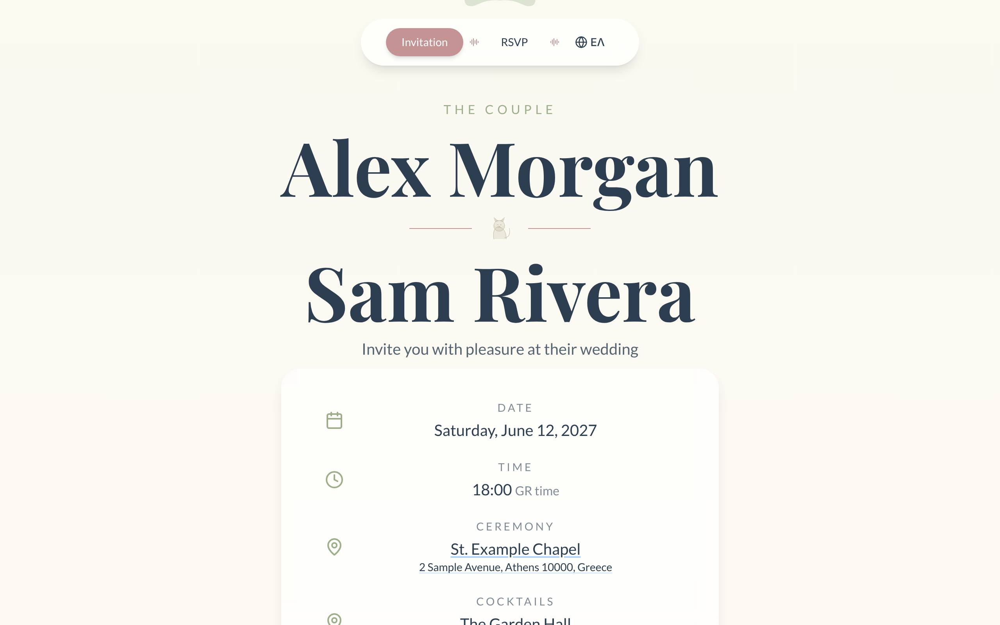
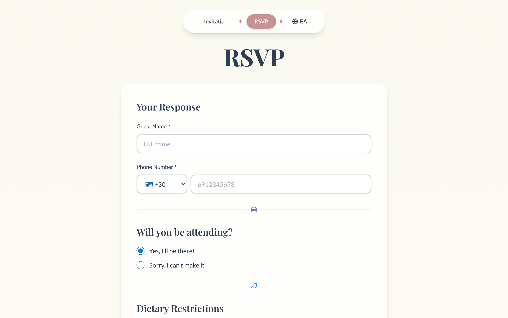
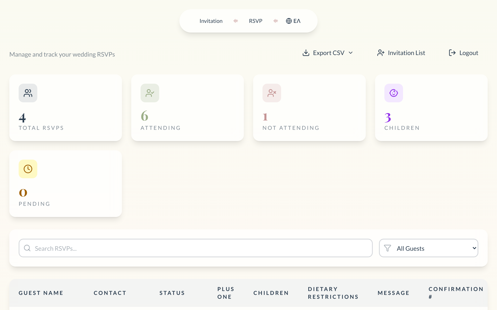

# Wedding RSVP

[](https://github.com/MichaelGeranis/wedding/actions/workflows/ci.yml)
[](LICENSE)

**A bilingual wedding invitation site with RSVPs, QR-code invitations and a guest dashboard.**

Guests open a personal link (or scan the QR code on their printed card), see the
invitation in English or Greek, and RSVP in under a minute. The couple sees every
answer, headcount, child and dietary note in one admin dashboard, and exports the
lot to CSV for the venue.

| Invitation | RSVP | Admin dashboard |
|---|---|---|
|  |  |  |

Built for my own wedding, and open-sourced so others can use it for theirs.

## Features

- **Invitation page** with countdown, ceremony and reception venues, map links,
  "add to calendar" and a weather forecast for the day.
- **RSVP form** with plus-ones, children and dietary restrictions, and a
  confirmation number. Rate-limited per IP.
- **Personal QR codes.** Each invited guest gets a unique link that opens the
  RSVP form with their name and phone filled in.
- **Invitation list.** Import guests from CSV, track who was sent an invitation
  and who has answered, and tag `#child` / `#plusone` in notes for an accurate
  headcount.
- **Admin dashboard** with totals, search and filters, and CSV exports.
- **English and Greek** throughout, including confirmation emails.
- **Optional email** confirmations to guests and notifications to the couple.

## Try it in one command

You need [Docker](https://docs.docker.com/get-docker/) and nothing else.

```bash
git clone https://github.com/MichaelGeranis/wedding.git
cd wedding
docker compose up --build
```

Open <http://localhost:3000>. The admin dashboard is at
<http://localhost:3000/admin>: username `admin`, password `demo-admin`.

The demo uses the public values in [`docker/demo.env`](docker/demo.env) and a
sample couple. The ports are bound to `127.0.0.1`, so it is only reachable from
your machine. `docker compose down -v` resets everything.

## Make it yours

1. Copy `backend/.env.example` to `backend/.env`. It is loaded after
   `docker/demo.env` and overrides it.
2. Generate your own JWT secret and admin password hash:
   ```bash
   cd backend && uv run python scripts/generate_secrets.py
   ```
3. Put your names, date and venues in
   [`backend/scripts/init_db.py`](backend/scripts/init_db.py) before the first
   start (it seeds the invitation only into an empty database). Greek versions
   of the names and venues go in the `*_gr` columns.
4. The weather forecast uses the coordinates passed to `WeatherWidget` in
   [`frontend/src/pages/Invitation.jsx`](frontend/src/pages/Invitation.jsx).
5. Set `ENVIRONMENT=production`, `FRONTEND_URL` and `CORS_ORIGINS` to your
   domain. The API refuses to start outside development with the demo secret.

To host it, [DEPLOYMENT.md](DEPLOYMENT.md) walks through AWS (ECS Fargate, RDS,
CloudFormation); any host that runs Docker Compose works too.

## Tech stack

| Layer | Technology |
|-------|-----------|
| Backend | Python 3.13, FastAPI, async SQLAlchemy, Alembic, Pydantic settings, SlowAPI |
| Frontend | React 18, Vite, Tailwind CSS, React Hook Form + Zod, i18next, Framer Motion |
| Database | PostgreSQL 16 |
| Infrastructure | Docker Compose; AWS CloudFormation (ECS Fargate, RDS) |
| Testing | pytest (in-memory SQLite), ESLint |

The backend is layered: routes handle HTTP, services hold the rules,
repositories do data access, and one dependency (`get_db`) owns each request's
transaction. See [CLAUDE.md](CLAUDE.md) for the conventions in detail.

## Development

Prerequisites: Python 3.13, [uv](https://docs.astral.sh/uv/), Node.js 20+ and Docker.

```bash
make install                      # backend (uv) and frontend (npm) dependencies
cp backend/.env.example backend/.env
cd backend && uv run python scripts/generate_secrets.py && cd ..   # paste the output into backend/.env
docker compose up -d postgres     # the database
cd backend && uv run python scripts/init_db.py && cd ..           # tables, sample invitation, admin user
make dev-backend                  # http://localhost:8000 (API docs at /docs)
make dev-frontend                 # http://localhost:5173, in a second terminal
```

Run the checks before a pull request:

```bash
make test                         # backend tests (no database needed)
make lint-backend
make lint-frontend
```

Database migrations, troubleshooting and the API reference are in
[docs/development.md](docs/development.md).

## Project layout

```
backend/
  src/wedding_api/   FastAPI app: api/routes, services, repositories, models, utils
  alembic/           Database migrations
  scripts/           init_db.py (tables, sample data, admin user), generate_secrets.py, backups
  tests/             unit/ and integration/ (pytest, in-memory SQLite)
frontend/
  src/               pages/, components/, i18n/locales (en, el), services/api.js
infrastructure/      AWS CloudFormation stack and deploy scripts
docker/demo.env      Public demo configuration for `docker compose up`
```

## Contributing

Contributions are welcome. Read [CONTRIBUTING.md](CONTRIBUTING.md) for setup and
how to submit a change. This project follows a [Code of Conduct](CODE_OF_CONDUCT.md).
To report a security problem, see [SECURITY.md](SECURITY.md); please do not open
a public issue.

## License

Licensed under the [Apache License 2.0](LICENSE).
